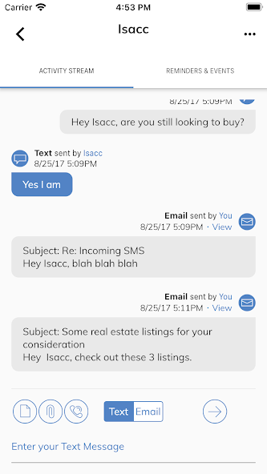
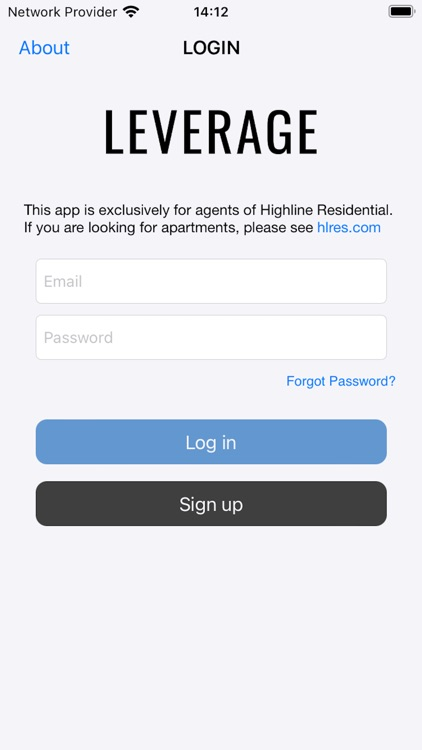

<h1 align="center">Mughees Mustafa</h1>

<p align="center">
  <strong>Principal Mobile Engineer · iOS · Flutter · AI-First Development</strong><br>
  Building production mobile products, scalable architectures, and agent-assisted engineering workflows.
</p>

<p align="center">
  <a href="https://www.linkedin.com/in/mughees-mustafa-6bb7723b/">LinkedIn</a>
  ·
  <a href="mailto:mughees93@hotmail.com">Email</a>
  ·
  <a href="https://www.coursera.org/account/accomplishments/professional-cert/FKR4LZUKBMC2">IBM Data Science Credential</a>
</p>

---

## About me

I’m a mobile engineer with **10+ years of experience** building and leading iOS and Flutter products for startups and enterprise teams across the US, UK, Europe, and Pakistan.

My work covers the full product lifecycle: requirements, Clean Architecture, hands-on implementation, third-party integrations, code and pull-request reviews, releases, and production support. I currently lead mobile development for a real-estate platform with listings, lead management, ad creation, VoIP, messaging, email, document workflows, PDF editing, and e-signing.

I also design **AI-first development workflows** using ChatGPT, Claude, and specialized agents that support planning, coding, debugging, documentation, pull-request review, testing, and release validation.

## Engineering focus

| Mobile product engineering | AI-assisted delivery | Technical leadership |
| --- | --- | --- |
| Native iOS, Flutter, and Clean Architecture | Agentic coding and agent orchestration | Architecture and delivery ownership |
| App Store and Google Play delivery | ChatGPT, Claude, Ollama, and RAG | Code reviews and pull-request reviews |
| Firebase, VoIP, Stripe, in-app purchases, subscriptions, analytics, and push | Coding, review, documentation, and testing agents | Mentoring and stakeholder collaboration |

## Selected products

### Leverage Agent App · 2023–Present

A cross-platform workspace for real-estate agents featuring property listings and search, ad creation, lead management, VoIP calls, messages and email, attachments, PDF editing, and e-signing.

[App Store](https://apps.apple.com/in/app/leverage-agent-app/id1468437548) · [Google Play](https://play.google.com/store/apps/details?id=com.hlres.leverage)

<p align="center">
  
  &nbsp;&nbsp;&nbsp;
  
</p>

<p align="center"><sub>Android communication workflow · iOS agent login</sub></p>

### Sixty Four Squares · 2024–2026

A subscription chess-learning experience with study plans, timers, progress dashboards, skill tracking, analytics, and in-app purchases.

[App Store](https://apps.apple.com/us/app/sixty-four-squares/id1612844081) · [Google Play](https://play.google.com/store/apps/details?id=com.sixtyfoursquares.sixtyfoursquare)

### BJJ Coach Online · 2023–2026

A subscription education platform with 1,800+ streaming videos, structured curricula, specialized courses, trial access, and in-app purchases.

[App Store](https://apps.apple.com/us/app/bjj-coach-online-jiu-jitsu/id6477537913) · [Google Play](https://play.google.com/store/apps/details?id=com.vensoc.bjjonline.bjj_coach_online)

### Smart Fan Box

An industrial iOS application for monitoring and controlling connected fan systems through BLE and IoT integrations, including environmental sensor readings, schedules, energy usage, system status, and remote diagnostics.

[App Store](https://apps.apple.com/us/app/smart-fan-box/id1479039855)

### SMA CRC

An enterprise iOS application for credentialed Edwards Lifesciences customers to record and track medical devices and instruments across hospital sites. My work included RFID scanning, resilient offline-first storage and synchronization, Salesforce-backed workflows, and extending a legacy Objective-C application with new Swift modules.

[App Store](https://apps.apple.com/us/app/sma-crc/id1486732314)

### Flare — Watch, Swipe, Shop

A video-first ecommerce marketplace where shoppers could discover products through short shoppable videos, search by category, evaluate products, and complete purchases through a streamlined mobile checkout.

[App Store](https://apps.apple.com/us/app/flare-watch-swipe-shop/id1595078857)

### MyBusks

A cross-platform social crowdfunding app for buskers and aspiring creators. Performers could upload videos, build follower communities, receive donations, and let audiences share or repost campaigns.

[Community](https://www.instagram.com/mybusks/)

### Local-First AI Chatbot · Recent work

A privacy-focused assistant using open-source Ollama models, retrieval-augmented generation, semantic document search, FastAPI, and on-device PDF OCR.

## Enterprise application delivery

At Xavor Corporation, I supported Edwards Lifesciences as an outsourced iOS engineer and helped manage an enterprise catalog of **150+ applications** through **Digital.ai App Management—formerly Apperian**. The work included application onboarding, updates, access management, and secure internal distribution to authorized enterprise users.

## Technology

**Mobile**


`UIKit` · `RxSwift` · `Clean Architecture` · `MVVM` · `VIPER` · `Flutter platform channels`

**Integrations and delivery**


`Push notifications` · `VoIP` · `BLE` · `IoT` · `RFID` · `Offline-first synchronization` · `Salesforce` · `REST APIs` · `Stripe payment gateway integration` · `In-app purchases` · `Subscriptions` · `Digital.ai App Management` · `Apperian` · `Enterprise app distribution` · `CI/CD` · `App Store Connect` · `Google Play Console`

**AI and data**


`Agentic coding` · `Agent orchestration` · `Ollama` · `RAG` · `SQL` · `Data analysis` · `Data visualization` · `Machine learning`

## AI engineering workflow

```text
Understand  → product intent, constraints, and system context
Orchestrate → focused agents for research, implementation, docs, and testing
Review      → code, pull requests, risks, and test coverage
Deliver     → integrate feedback, validate behavior, and ship confidently
```

## Data science

Completed the **IBM Data Science Professional Certificate** on Coursera, a 12-course program covering Python, SQL, Jupyter, data analysis, visualization, machine learning, applied data science, generative AI, and a hands-on capstone.

[View verified credential](https://www.coursera.org/account/accomplishments/professional-cert/FKR4LZUKBMC2)

---

<p align="center">
  Open to conversations about mobile architecture, engineering leadership, and practical AI workflows.
</p>
